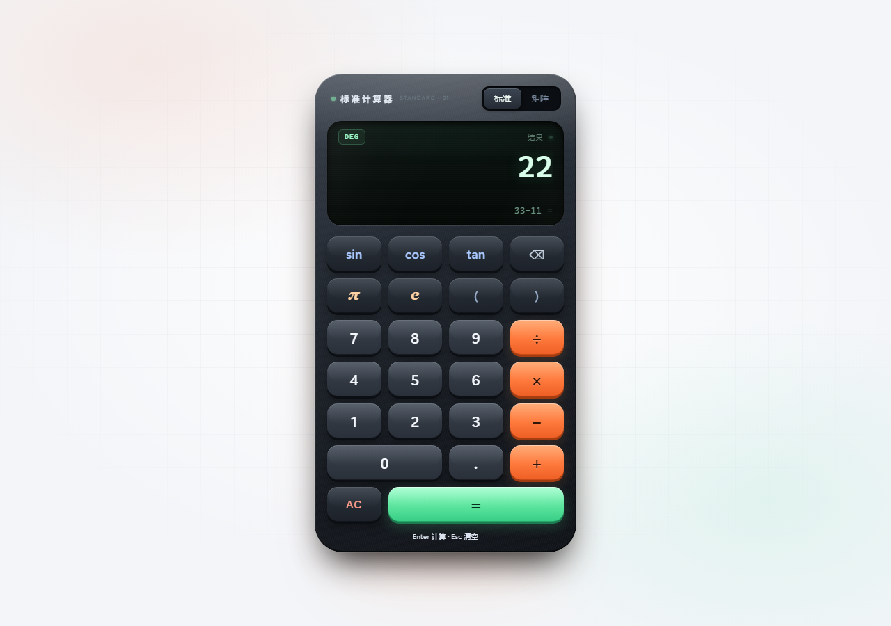
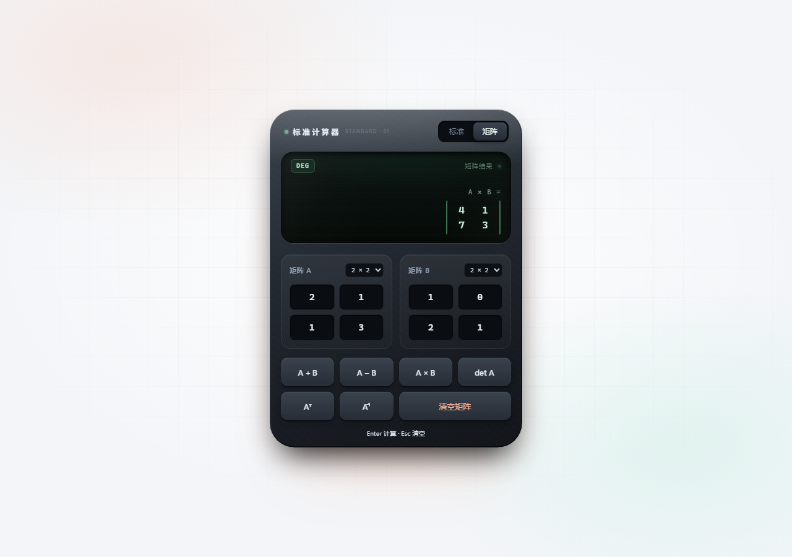
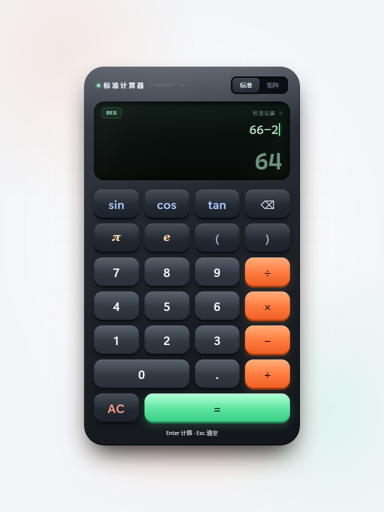
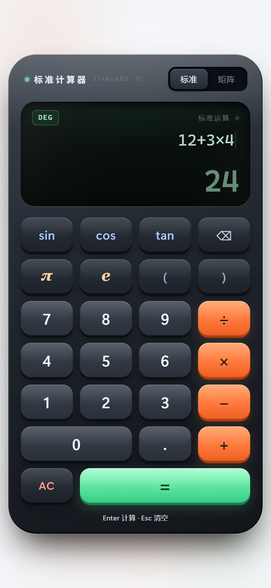
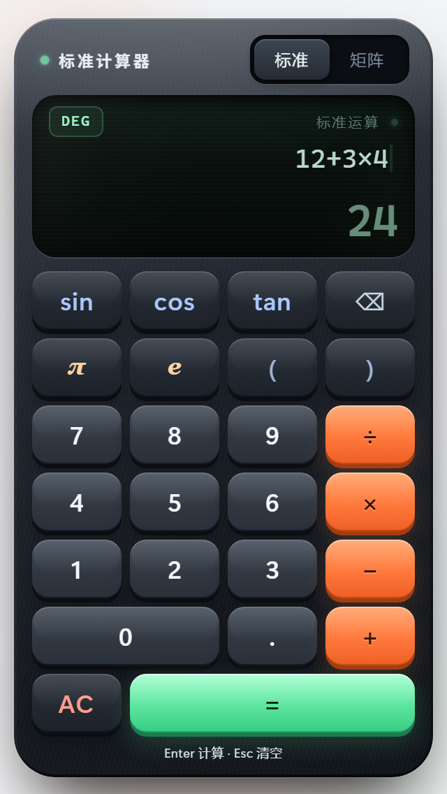
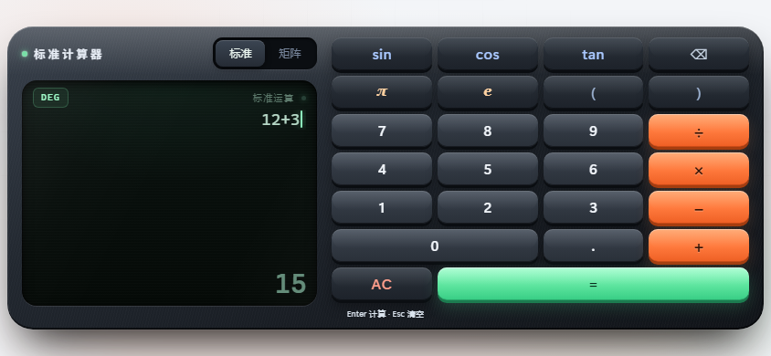

# 标准计算器

一个现代桌面计算器风格的静态网页：深色金属机身、绿色 LCD 屏、白色浅底；支持四则运算、三角/常数、表达式原位编辑与 2×2 / 3×3 矩阵运算，并针对手机、平板与横屏做了响应式适配。

无依赖、无需构建，双击 `index.html` 即可运行。

## 预览

| 输入中：算式在上，实时结果在下 | 按下等号：结果平滑移到上方 |
| --- | --- |
|  |  |

| 矩阵 A × B | 点击算式中的 × 原位编辑 |
| --- | --- |
|  |  |

| 平板（768 × 1024） | 手机（390 × 844） | 小屏（320 × 568） | 横屏（844 × 390） |
| --- | --- | --- | --- |
|  |  |  |  |

另有 `preview-pressed.png`（按键按下态）、`preview-tablet-matrix.png`、`preview-mobile-matrix.png`（平板/手机矩阵态）。

## 功能

- **标准运算**：`+ − × ÷`、括号、小数、退格与清空，支持隐式乘法（如 `2(3+4)`）。负数可直接输入，例如 `−` `5`。
- **负数输入**：空算式上直接按 `−` 再输数字就是负数（如 `−5`），不会显示成 `0−5`；`3 − 5` 这类二元减法不受影响。
- **算式原位编辑**：点击屏幕上算式里的任意字符即可选中它，再按运算符或数字就会原位替换。例如 `−3×(−5)` 里点一下 `×` 再按 `÷`，直接变成 `−3÷(−5)`；也可以用 `←` `→` / `Home` / `End` 移动光标后输入，`Backspace` 删左侧、`Delete` 删右侧，不必再从右往左退格。
- **函数与常数**：`sin` `cos` `tan`，常用常数 `π` `e`，支持 DEG / RAD 切换（点击屏幕左上角的角度徽标）。
- **矩阵**：2×2 / 3×3 的 A、B 矩阵，支持加、减、乘、行列式、转置、求逆。打开页面时矩阵为空白格，标准/矩阵模式来回切换不会丢失已填数字；单元格只接受数字，含字母或空值时给出中文提示并标红；尺寸不匹配、不可逆、除零同样有提示；`Esc` 一键清空全部矩阵单元格，`Enter` 重复最近一次矩阵运算（尚未运算时默认 A × B）。
- **结果动效**：输入时算式在上、实时结果在下；按下 `=` 或 Enter 后，结果从下方平滑移动到上方，算式落到次行。
- **完成后继续**：计算完成后按 `+ − × ÷` 会以上一次结果为起点接着算（如 `66−2=64` 后按 `+6=` 得 `70`）；按数字、`sin` 等函数、`π` `e`、退格则会清空上一次结果，从空白算式重新开始。
- **屏幕粘贴**：点击屏幕（或直接按 `Ctrl+V`）即可粘贴算式，自动兼容 `× ÷ −`、千分位逗号与 `π`；粘贴内容会先试算，非法字符给出提示。
- **交互反馈**：按下按键会下沉并缩小到 94%，松手回弹；错误时屏幕抖动。
- **响应式**：桌面 376px 单列；平板（≥700px 宽、≥860px 高）放大到 432px（矩阵 460px）；窄屏手机按 320–400px 逐级收缩按键与字号；手机横屏改为左右双栏（左侧屏幕、右侧键盘），矩阵面板自动铺满两栏。
- **外观**：白色浅底配柔和光晕，深色金属机身与绿色 LCD 屏保持高对比。

## 键盘快捷键

| 按键 | 作用 |
| --- | --- |
| `0-9` `.` | 输入数字 |
| `+ - * /` | 运算符 |
| `(` `)` | 括号 |
| `P` / `E` | 输入 π / e |
| `Enter` / `=` | 标准模式：计算；矩阵模式：重复最近一次矩阵运算 |
| `Backspace` | 退格（有选中字符时删除选中） |
| `Delete` | 删除光标右侧字符 |
| `←` `→` / `Home` / `End` | 在算式中移动光标 |
| `Esc` | 标准模式：清空算式；矩阵模式：清空 A/B 全部单元格 |
| `Ctrl+V` | 在屏幕上粘贴算式（先点击屏幕获得焦点） |

## 本地运行

直接双击 `index.html`，或在该目录启动任意静态服务器：

```bash
python -m http.server 4173
# 然后访问 http://127.0.0.1:4173
```

`file://` 下也可完整运行。

## 文件结构

- `index.html` — 页面结构（机身、屏幕、25 键键盘、矩阵面板）
- `styles.css` — 金属机身、LCD 屏幕、按键反馈与全部响应式断点
- `core.js` — 表达式解析与求值、数字格式化（可独立在 Node 中测试）
- `app.js` — 状态机、按键/键盘/粘贴事件、矩阵运算与渲染
- `preview-*.png` — 各尺寸预览图

## 响应式断点

| 条件 | 行为 |
| --- | --- |
| 默认 | 376px 机身、50px 按键、44px 结果字 |
| `max-width: 380px` | 收窄机身与屏幕字号，26px 小结果字 |
| `max-height: 700px` | 矮屏：屏幕压到 132px、按键 44px、收窄间距 |
| `max-width: 400px` 且 `max-height: 700px` | 320px 级小屏：42px 按键、更紧的机身与字号，保证 320×568 不滚动 |
| `700–1100px` 宽且 `≥860px` 高 | 平板：432px 机身（矩阵 460px）、57px 按键、更大结果字 |
| `max-height: 560px` 且横屏 | 左右双栏：左侧屏幕、右侧键盘；矩阵面板跨两栏并压缩输入框与按钮 |

## 部署

当前是纯静态站点，可直接托管到任意静态服务器，或把整个 `calc/` 目录作为子目录上传到 GitHub Pages 仓库（HTML 内全部使用相对路径）。

## 浏览器支持

面向现代常青浏览器（Chrome / Edge / Firefox / Safari 新版），使用 CSS Grid、Web Animations API 与 `matchMedia`。不支持 IE。